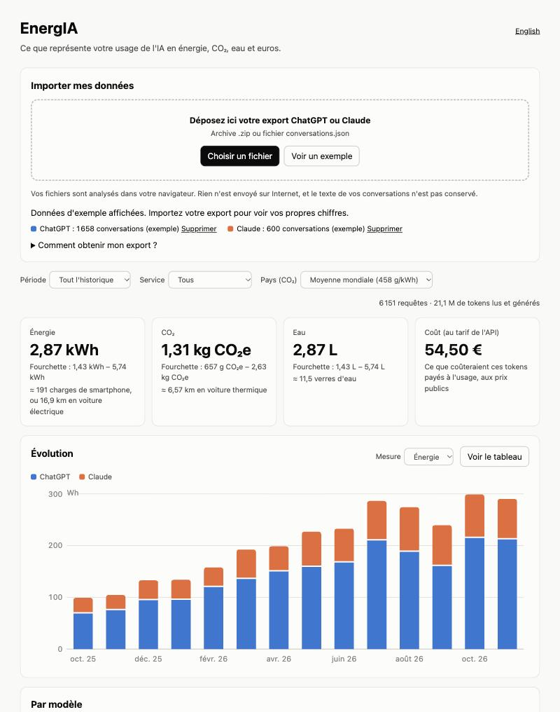
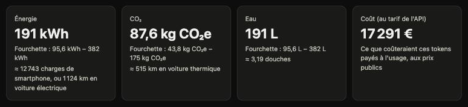

# EnergIA

[English](README.md) · **Français**

Ce que représente votre usage de l'IA, en énergie, CO₂, eau et euros.

EnergIA estime l'empreinte de vos conversations avec ChatGPT, Claude, Claude Code et Claude Cowork. Elle
existe sous deux formes, qui partagent la même page :

- une **page web** où l'on importe son export ChatGPT ou Claude, à
  [essayer en ligne](https://darkxander.github.io/EnergIA/) sans rien installer ;
- un **élément de barre de menus macOS** (plugin [SwiftBar](https://github.com/swiftbar/SwiftBar))
  qui affiche l'énergie estimée du jour pour Claude Code, et ouvre le tableau de bord au clic.



*Le tableau de bord, ici avec les données d'exemple intégrées.*



*Les tuiles de résumé, ici pour un usage réel de Claude Code sur huit mois, avec la moyenne
mondiale pour le CO₂.*

Tous les chiffres sont des **estimations d'ordre de grandeur** : les fournisseurs ne
publient pas la consommation réelle de leurs modèles. Voir [Limites](#limites).

## Ce qu'elle affiche

- Quatre tuiles : énergie, CO₂, eau et coût, avec une fourchette basse et haute et des
  équivalents (charges de smartphone, kilomètres en voiture, verres d'eau).
- Un graphique par jour ou par mois, par service, avec une vue tableau.
- Un tableau par modèle.
- Un filtre de période (de « Aujourd'hui » à tout l'historique) et de service.
- Le choix du pays dont l'électricité sert au calcul du CO₂ (27 pays et régions).
- L'écart avec la période précédente, sur les tuiles d'énergie et de coût, dès qu'une
  période est choisie.
- Un seuil d'énergie par jour, facultatif : la page indique où vous en êtes, et signale un
  dépassement.
- Des hypothèses de calcul toutes modifiables.

L'appli existe en français et en anglais. Elle suit la langue du navigateur (français pour
un navigateur en français, anglais sinon), et le lien en haut à droite de la page change
de langue.

## Utiliser la page web

Le plus simple est la version en ligne : <https://darkxander.github.io/EnergIA/>. C'est la même page, hébergée par
GitHub Pages ; vos fichiers restent analysés dans votre navigateur et ne sont envoyés nulle
part. Il faut un navigateur de 2021 environ ou plus récent, et de 2023 ou plus récent pour
ouvrir directement les archives `.zip` ; sur un navigateur plus ancien, la page le signale
au lieu de rester vide.

Pour la faire tourner vous-même, il faut un serveur local, la page chargeant des modules
JavaScript :

```sh
python3 -m http.server 8791 --bind 127.0.0.1
```

Ouvrez ensuite <http://localhost:8791>, puis importez votre export (`.zip` ou
`conversations.json`) : déposez-le n'importe où sur la page, ou cliquez sur « Choisir un
fichier ». « Voir un exemple » affiche des données fictives.

Pour obtenir un export :

- **ChatGPT** : Paramètres → Gestion des données → Exporter les données.
- **Claude** : Paramètres → Confidentialité → Exporter les données, sur le web ou dans
  l'appli pour ordinateur (pas sur mobile). Le lien reçu par e-mail expire au bout de
  24 heures.

Les fichiers sont analysés dans le navigateur. Rien n'est envoyé sur Internet, et le
texte des conversations n'est pas conservé : seuls des compteurs par jour et par modèle
sont gardés dans le stockage local du navigateur.

## Installer dans la barre de menus (macOS)

Prérequis : macOS, Python 3.9 ou plus récent, et SwiftBar.

```sh
brew install --cask swiftbar
chmod +x EnergIA.py
ln -s "$PWD/EnergIA.py" ~/.config/swiftbar/EnergIA.py
```

Remplacez `~/.config/swiftbar` par votre dossier de plugins SwiftBar s'il est différent.
Le titre affiche par exemple `⚡ 1,02 kWh` (`⚡ 1.02 kWh` en anglais) ; un clic ouvre le
tableau de bord. Si vous avez fixé un seuil d'énergie par jour dans les hypothèses de
calcul, l'éclair devient un point rouge (`🔴 1,02 kWh`) quand il est dépassé.

Si la barre de menus est chargée, macOS masque sans prévenir les éléments qui ne tiennent
plus, surtout sur un écran à encoche. La case « Titre compact », dans les hypothèses de
calcul de la fenêtre du plugin, raccourcit alors le titre : sans espaces, avec moins de chiffres et dans un texte un peu
plus petit (`⚡523Wh`, `⚡1,3kWh`). Cela suffit souvent à le faire tenir, sans garantie. Le plugin reprend la langue affichée dans la page, et celle de macOS tant
que la page n'a pas été ouverte.


*L'élément dans la barre de menus, ici avec 137 Wh estimés pour la journée en cours.*

Le plugin :

- lit les journaux locaux de Claude Code (`~/.claude/projects`), où chaque réponse est
  enregistrée avec son modèle et ses nombres de tokens réels, et les relit chaque minute ;
- lit de la même façon les sessions Cowork de l'appli Claude
  (`~/Library/Application Support/Claude/local-agent-mode-sessions`), affichées comme un
  service à part ;
- n'en garde que des compteurs par jour et par modèle, dans `~/Library/Caches/EnergIA` ;
  ces compteurs survivent au nettoyage des anciens journaux par Claude Code ;
- sert la page sur `127.0.0.1:18791`, accessible uniquement depuis votre Mac ;
- relève une fois par jour le taux de change euro/dollar de référence de la BCE. C'est sa
  seule connexion à Internet ; elle n'envoie aucune donnée.

Pour importer un export depuis la fenêtre de la barre de menus, utilisez le bouton
« Choisir un fichier » : le plugin ouvre le sélecteur de fichier de macOS et transmet à la
page le fichier choisi. Le glisser-déposer n'y est pas possible, car SwiftBar referme sa
fenêtre dès qu'on commence à faire glisser un fichier. Les liens du pied de page (don,
code source) s'ouvrent dans votre navigateur par défaut.

Pour désinstaller, supprimez le lien `~/.config/swiftbar/EnergIA.py`, puis quittez et
relancez SwiftBar.

## Mode « serveur seul » (Windows, Linux, macOS)

Sans SwiftBar, le même programme peut tourner seul et ouvrir le tableau de bord dans votre
navigateur, avec les mesures de Claude Code en direct. Il suffit de Python 3.9 ou plus
récent :

```sh
python3 EnergIA.py --serve
```

Sous Windows, la commande est en général `py EnergIA.py --serve`. Le tableau de bord s'ouvre
sur `http://127.0.0.1:18791/` ; arrêtez le programme avec Ctrl+C. Deux options : `--port`
pour changer de port, `--no-browser` pour ne pas ouvrir le navigateur.

Dans ce mode, l'import d'un export et les liens fonctionnent comme dans la version en
ligne. Les compteurs et réglages sont gardés dans les dossiers habituels du système
(`%LOCALAPPDATA%` et `%APPDATA%` sous Windows, `~/.cache` et `~/.config` sous Linux).

Ce mode a été vérifié sous macOS et sous Linux (Debian, dans un conteneur, avec
Python 3.12 et 3.13). Il n'a pas encore été essayé sous Windows : si vous l'y lancez, un
retour dans une [issue](https://github.com/darkxander/EnergIA/issues) est bienvenu.
L'emplacement des sessions Cowork sous Windows, en particulier, est une supposition.

## Comment sont faites les estimations

1. **Tokens.** Pour les exports ChatGPT et Claude, le nombre de tokens est estimé à partir
   de la longueur du texte (environ 4 caractères par token), et le contexte relu à chaque
   réponse est compté. Pour Claude Code, les tokens sont mesurés, pas estimés.
2. **Énergie.** Chaque modèle est rangé dans une catégorie (léger, standard, grand,
   raisonnement) qui fixe une énergie par millier de tokens générés. Un token lu pèse une
   fraction d'un token généré, et un token relu depuis le cache une fraction plus petite
   encore.
3. **CO₂ et eau.** L'énergie est multipliée par une intensité carbone (g CO₂e/kWh) et par
   une consommation d'eau (L/kWh). L'intensité carbone est celle du pays choisi, par défaut
   la moyenne mondiale (458 g CO₂e/kWh en 2025). Les valeurs par pays
   ([src/carbon.json](src/carbon.json)) sont des émissions sur le cycle de vie, relevées le
   27 novembre 2026 : Ember (2026), avec le traitement d'[Our World in Data](https://ourworldindata.org/grapher/carbon-intensity-electricity).
4. **Coût.** Ce que coûteraient ces tokens payés à l'usage, aux prix publics des API
   Anthropic et OpenAI ([src/prices.json](src/prices.json)), convertis en euros.

Les valeurs par défaut sont dans [src/defaults.json](src/defaults.json) et se modifient
dans « Hypothèses de calcul ».

## Limites

- **L'énergie par token n'est pas publiée.** Les facteurs par défaut sont des choix
  d'ordre de grandeur, calés sur les rares chiffres publics (environ 0,3 Wh pour une
  requête de chat typique).
- **Le poids des tokens relus du cache est l'hypothèse la plus incertaine.** Ils
  représentent l'essentiel du volume de Claude Code, et leur poids (2 % d'un token lu par
  défaut) change fortement le total.
- **Le pays à choisir est celui où tournent les modèles, pas forcément le vôtre.** Les
  fournisseurs ne disent pas dans quel centre de données une requête est traitée ; la
  moyenne mondiale est un choix par défaut, pas une mesure.
- **Le coût n'est pas votre facture.** Avec un abonnement, vous payez le forfait, pas les
  tokens. Les prix actuels sont appliqués à tout l'historique.
- **Prix à maintenir.** Les prix de [src/prices.json](src/prices.json) ont été relevés le
  25 novembre 2026 et ne se mettent pas à jour seuls. Pour les anciens modèles retirés de
  l'API (GPT-3.5 Turbo, GPT-4, GPT-4 Turbo, GPT-4.5, o3-mini, o4-mini, recherche
  approfondie), c'est le dernier prix publié par OpenAI, relevé le 26 novembre 2026. Les
  modèles absents de la liste gardent un tarif indicatif par catégorie, signalé par un
  astérisque.
- **Les noms de modèles de ChatGPT ne sont pas ceux de l'API.** L'export ChatGPT désigne
  les modèles par des noms internes. Quand la correspondance est connue (par exemple
  `text-davinci-002-render-sha` pour GPT-3.5, ou `o3-mini-high` pour o3-mini), le prix réel
  est appliqué. OpenAI ne publie pas de correspondance pour les noms récents (`gpt-6`,
  `gpt-5-6`, `gpt-5-3`, leurs variantes mini, `research`, `auto`) : ils gardent le tarif
  indicatif.
- **Les conversations de claude.ai et de ChatGPT ne sont pas lues automatiquement.** Elles
  ne sont pas enregistrées sur le Mac sous une forme exploitable : il faut importer un
  export, à refaire pour mettre les chiffres à jour.
- **L'export Claude n'est pas toujours disponible.** Avec un compte d'organisation (Team ou
  Enterprise), le bouton d'export n'apparaît que si un propriétaire de l'organisation a
  autorisé les membres à exporter leurs données. Sans cela, les conversations de claude.ai
  ne peuvent pas être comptées.
- **Exports.** L'export Claude n'indique pas le modèle utilisé. La réflexion cachée des
  modèles à raisonnement n'apparaît pas dans les exports, et les images ne sont pas comptées.
  La lecture a été vérifiée sur un vrai export ChatGPT ; celle de l'export Claude ne l'a
  été que sur des fichiers de test.

## Organisation du code

| Chemin | Rôle |
|---|---|
| `index.html`, `styles.css`, `src/app.js` | La page et son interface |
| `src/parsers.js`, `src/zip.js` | Lecture des exports ChatGPT et Claude |
| `src/i18n.js` | Textes de l'interface en français et en anglais |
| `src/model.js` | Calcul de l'énergie, du CO₂, de l'eau et du coût |
| `src/defaults.json`, `src/prices.json`, `src/carbon.json` | Hypothèses par défaut, prix des modèles, intensité carbone par pays |
| `EnergIA.py`, `menubar/` | Plugin SwiftBar et mode « serveur seul » : journaux Claude Code, serveur local, taux de change |
| `tools/stamp.mjs` | Numérote les fichiers de la page à chaque version |
| `test/` | Tests |

Aucune dépendance : JavaScript sans étape de construction, Python avec la bibliothèque
standard seule.

## Tests

```sh
node --test test/
python3 test/test_menubar.py
```

Après une modification de `styles.css` ou d'un fichier de `src/`, lancez
`node tools/stamp.mjs`. Il inscrit dans `index.html` un numéro de version calculé d'après
ces fichiers, pour que les navigateurs ne mélangent jamais une nouvelle page avec un ancien
script gardé en mémoire. Les tests échouent si le numéro n'est plus à jour.

## Feuille de route

Ce sont des intentions, sans date ni engagement. Dans l'ordre envisagé :

1. **Autres systèmes.** Le mode « serveur seul » existe et fonctionne sous Linux ; il
   reste à le vérifier sous Windows, puis à ajouter une icône dans la zone de notification.
2. **L'anglais partout.** La page, le plugin de la barre de menus, le README et la
   description du dépôt sont traduits. Restent en français : les commentaires du code et
   les messages de commit.
3. **Faire connaître EnergIA.** Le but est de sensibiliser à ce que représente l'usage de
   l'IA ; les dons de celles et ceux qui trouvent l'appli utile financent son
   développement. Cela passe par des présentations de l'appli là où l'on parle d'IA et
   d'environnement.

Puis, sans ordre arrêté :

- **Autres services** : Gemini, Mistral, Copilot et d'autres outils de code, selon ce que
  permettent leurs exports.
- **Seuil en euros ou par mois**, en plus du seuil d'énergie par jour.
- **Export des résultats** : fichier CSV et image de résumé à partager.
- **Imports qui se cumulent**, au lieu de remplacer le précédent.
- **Installation en une commande.**
- **Version équipe, à l'étude** : l'usage de l'IA additionné pour une équipe ou une
  organisation, avec un rapport. Si cela vous intéresse, dites-le dans une
  [issue](https://github.com/darkxander/EnergIA/issues).

À consolider en parallèle : la lecture d'un vrai export Claude, et la mise à jour des prix,
aujourd'hui manuelle.

## Soutenir le projet

EnergIA est gratuite et ouverte. Si elle vous est utile, vous pouvez soutenir son
développement par un don sur [GitHub Sponsors](https://github.com/sponsors/darkxander).

## Licence

EnergIA est distribuée sous la licence publique générale GNU, version 3 (GPL-3.0). Voir
[LICENSE](LICENSE).

Copyright © 2026 Alexandre MATHIEU
