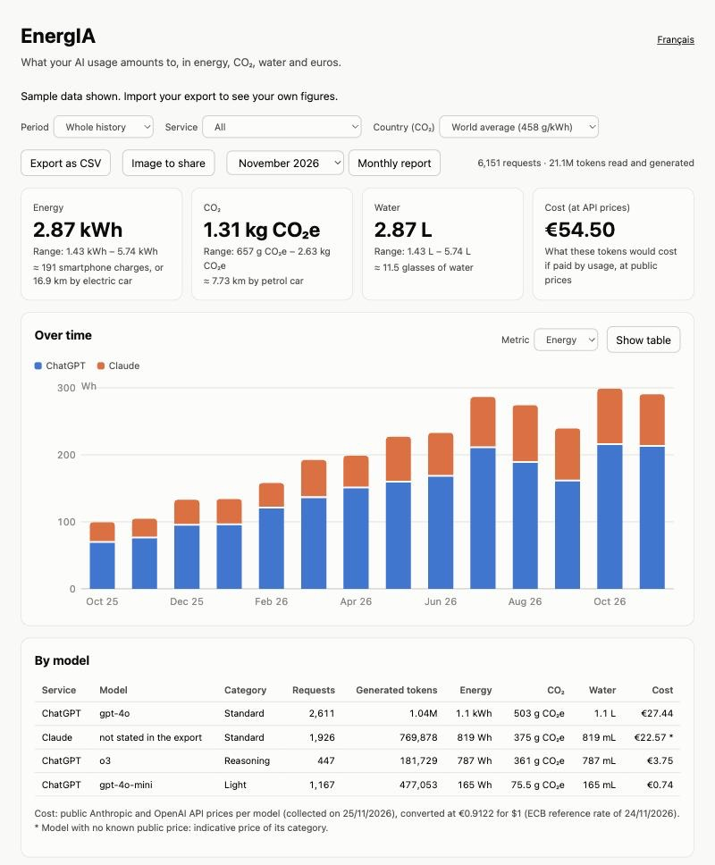
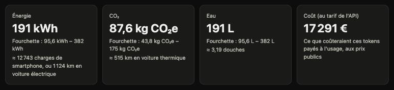

# EnergIA

**English** · [Français](README.fr.md)

What your AI usage amounts to, in energy, CO₂, water and euros.

EnergIA estimates the footprint of your conversations with ChatGPT, Claude, Gemini, Copilot,
Claude Code and Claude Cowork. It comes in two forms that share the same page:

- a **web page** where you import your ChatGPT, Claude, Gemini or Copilot export, which you can
  [try online](https://darkxander.github.io/EnergIA/) without installing anything;
- a **macOS menu bar item** ([SwiftBar](https://github.com/swiftbar/SwiftBar) plugin) that
  shows today's estimated energy for Claude Code and opens the dashboard on click.

The app is in English and French. It follows your browser's language (French for a French
browser, English otherwise), and the link at the top right of the page switches language.



*The dashboard, here with the built-in sample data.*



*The summary tiles, here for eight months of real Claude Code usage, with the world average
for CO₂.*

All figures are **order-of-magnitude estimates**: providers do not publish the actual
consumption of their models. See [Limitations](#limitations).

## What it shows

- Four tiles: energy, CO₂, water and cost, each with a low and high range and equivalents
  (smartphone charges, kilometres by car, glasses of water).
- A chart by day or by month, by service, with a table view.
- A table by model.
- A period filter (from "Today" to the whole history) and a service filter.
- The choice of the country whose electricity is used to compute CO₂ (27 countries and
  regions).
- The change from the previous period, on the energy and cost tiles, as soon as a period is
  chosen.
- Optional alert thresholds, in energy or in euros, per day or per month: the page shows
  where you stand and flags when one is exceeded.
- A CSV export of the period and service shown: one row per day, per service and per
  model, with tokens, energy, CO₂, water and cost. In English the file uses commas and a
  decimal point; in French, semicolons and a decimal comma, as a spreadsheet set to French
  expects.
- A summary image to share (PNG, 1200 × 630): the four figures for the period and service
  shown, with their equivalents.
- Calculation assumptions that can all be changed.

## Using the web page

The simplest way is the online version: <https://darkxander.github.io/EnergIA/>. It is the same page, hosted by
GitHub Pages; your files are still analysed in your browser and are not sent anywhere. It
needs a browser from about 2021 or later, and from 2023 or later to open `.zip` archives
directly; on an older one, the page says so instead of staying blank.

To run it yourself, the page loads JavaScript modules, so it needs a local server:

```sh
python3 -m http.server 8791 --bind 127.0.0.1
```

Then open <http://localhost:8791> and import your export (`.zip`, `.json` or `.csv`):
drop it anywhere on the page, or click "Choose a file". "See an example" shows made-up
data.

To get an export:

- **ChatGPT**: Settings → Data controls → Export data.
- **Claude**: Settings → Privacy → Export data, on the web or in the desktop app (not on
  mobile). The link sent by email expires after 24 hours.
- **Gemini**: on [takeout.google.com](https://takeout.google.com), tick only "My Activity",
  then in its options keep only Gemini Apps and choose the JSON format. By default Google
  provides HTML, which is not read.
- **Copilot**: on [account.microsoft.com/privacy](https://account.microsoft.com/privacy),
  under Copilot, "Export all activity history". You get `.csv` files.

Files are analysed in the browser. Nothing is sent over the Internet, and the text of your
conversations is not kept: only counters per day and per model are stored in the browser's
local storage, grouped by conversation under an anonymous key.

A new import adds to the previous one for the same service. A conversation already imported
is not counted twice: it is updated if it has grown. So you can import a more recent export
of the same account, or the exports of several accounts. "Remove" starts again from
scratch.

## One-command install (macOS, Linux)

```sh
curl -fsSL https://raw.githubusercontent.com/darkxander/EnergIA/main/install.sh | sh
```

The script ([install.sh](install.sh)) does not ask for administrator rights. It needs
Python 3.9 or later. It:

- copies EnergIA into `~/.local/share/EnergIA`; run again, it updates that copy;
- creates the `energia` command in `~/.local/bin`, which opens the dashboard in your
  browser (the [server-only mode](#server-only-mode-windows-linux-macos));
- on macOS, links the plugin to SwiftBar. If SwiftBar is missing and Homebrew is present,
  it installs it with Homebrew; otherwise it tells you what to do. An EnergIA plugin
  already linked elsewhere is left as it is.

If you prefer to read a script before running it, download it first, then run
`sh install.sh`. To uninstall: `sh install.sh --uninstall` (counters and settings are
kept).

Checked on macOS and on Linux (Debian, in a container). There is no script for Windows:
use the server-only mode.

## Installing in the menu bar by hand (macOS)

Requirements: macOS, Python 3.9 or later, and SwiftBar.

```sh
brew install --cask swiftbar
chmod +x EnergIA.py
ln -s "$PWD/EnergIA.py" ~/.config/swiftbar/EnergIA.py
```

Replace `~/.config/swiftbar` with your SwiftBar plugin folder if it is different. The title
shows, for example, `⚡ 1.02 kWh` (`⚡ 1,02 kWh` in French); a click opens the dashboard. If
you have set an alert threshold in the calculation assumptions (energy or cost, per day or
per month), the lightning bolt becomes a red dot (`🔴 1.02 kWh`) as soon as one of them is
exceeded. For this the plugin only counts what it measures, Claude Code and Cowork; the
page also adds the imported exports.

When the menu bar is crowded, macOS silently hides the items that no longer fit, especially
on a screen with a notch. The "Compact title" checkbox, in the calculation assumptions of
the plugin window, then shortens the title: no bolt, no spaces and fewer digits (`523Wh`, `1.3kWh`). Above the
threshold, the text turns red. This is often enough to make it fit, with no guarantee. The
plugin uses the language shown in the page, and the language of macOS until the page has
been opened.


*The item in the menu bar, here with the compact title and an estimated 654 Wh for the current day.*

The plugin:

- reads Claude Code's local logs (`~/.claude/projects`), where each reply is recorded with
  its model and its real token counts, and re-reads them every minute;
- reads the Claude app's Cowork sessions the same way
  (`~/Library/Application Support/Claude/local-agent-mode-sessions`), shown as a separate
  service;
- keeps only counters per day and per model, in `~/Library/Caches/EnergIA`; these counters
  outlive Claude Code's clean-up of old logs;
- serves the page on `127.0.0.1:18791`, reachable only from your Mac;
- fetches the ECB's euro/dollar reference rate once a day. This is its only Internet
  connection; it sends no data.

To import an export from the menu bar window, use the "Choose a file" button: the
plugin opens the macOS file picker and passes the chosen file to the page. Drag and drop is
not possible there, because SwiftBar closes its window as soon as you start dragging a
file. The footer links (donation, source code) open in your default browser. The "Export
as CSV" and "Image to share" buttons save the file in your Downloads folder and show it in
the Finder, because this window cannot download.

To uninstall, delete the `~/.config/swiftbar/EnergIA.py` link, then quit and relaunch
SwiftBar.

## Server-only mode (Windows, Linux, macOS)

Without SwiftBar, the same program can run on its own and open the dashboard in your
browser, with live Claude Code measurements. All it needs is Python 3.9 or later:

```sh
python3 EnergIA.py --serve
```

On Windows, the command is usually `py EnergIA.py --serve`. The dashboard opens at
`http://127.0.0.1:18791/`; stop the program with Ctrl+C. Two options: `--port` to change the
port, `--no-browser` to leave the browser closed.

In this mode, importing an export and the links work as in the online version. Counters and
settings are kept in the system's usual folders (`%LOCALAPPDATA%` and `%APPDATA%` on
Windows, `~/.cache` and `~/.config` on Linux).

This mode has been checked on macOS and on Linux (Debian, in a container, with Python 3.12
and 3.13). It has not yet been tried on Windows: if you run it there, feedback in an
[issue](https://github.com/darkxander/EnergIA/issues) is welcome. The location of Cowork
sessions on Windows, in particular, is a guess.

## How the estimates are made

1. **Tokens.** For ChatGPT and Claude exports, the number of tokens is estimated from the
   length of the text (about 4 characters per token), and the context re-read at each reply
   is counted. For Claude Code, tokens are measured, not estimated.
2. **Energy.** Each model is placed in a category (light, standard, large, reasoning) that
   sets an energy per thousand generated tokens. A token read weighs a fraction of a token
   generated, and a token re-read from the cache a smaller fraction still.
3. **CO₂ and water.** Energy is multiplied by a carbon intensity (g CO₂e/kWh) and by a
   water consumption (L/kWh). The carbon intensity is that of the chosen country, the world
   average by default (458 g CO₂e/kWh in 2025). The values per country
   ([src/carbon.json](src/carbon.json)) are lifecycle emissions, collected on 27 November
   2026: Ember (2026), with processing by [Our World in Data](https://ourworldindata.org/grapher/carbon-intensity-electricity).
4. **Cost.** What these tokens would cost if paid by usage, at the public prices of the
   Anthropic and OpenAI APIs ([src/prices.json](src/prices.json)), converted to euros.

The default values are in [src/defaults.json](src/defaults.json) and can be changed under
"Calculation assumptions".

## Limitations

- **Energy per token is not published.** The default factors are order-of-magnitude
  choices, anchored on the few public figures (about 0.3 Wh for a typical chat request).
- **The weight of tokens re-read from the cache is the most uncertain assumption.** They
  make up most of Claude Code's volume, and their weight (2% of a token read by default)
  changes the total a great deal.
- **The country to choose is where the models run, not necessarily yours.** Providers do
  not say in which data centre a request is handled; the world average is a default
  choice, not a measurement.
- **The cost is not your bill.** With a subscription, you pay the plan, not the tokens.
  Current prices are applied to the whole history.
- **Prices need maintaining.** The prices in [src/prices.json](src/prices.json) were
  collected on 25 November 2026 and do not update themselves. For older models withdrawn
  from the API (GPT-3.5 Turbo, GPT-4, GPT-4 Turbo, GPT-4.5, o3-mini, o4-mini, deep
  research), it is the last price published by OpenAI, collected on 26 November 2026.
  Models missing from the list keep an indicative price per category, marked with an
  asterisk.
- **ChatGPT's model names are not the API's.** The ChatGPT export refers to models by
  internal names. When the correspondence is known (for example
  `text-davinci-002-render-sha` for GPT-3.5, or `o3-mini-high` for o3-mini), the real price
  is applied. OpenAI publishes no correspondence for recent names (`gpt-6`, `gpt-5-6`,
  `gpt-5-3`, their mini variants, `research`, `auto`): they keep the indicative price.
- **claude.ai and ChatGPT conversations are not read automatically.** They are not stored
  on the Mac in a usable form: you have to import an export, and import a new one to
  update the figures.
- **The Claude export is not always available.** With an organisation account (Team or
  Enterprise), the export button only appears if an owner of the organisation has allowed
  members to export their data. Without that, claude.ai conversations cannot be counted.
- **Exports.** The Claude export does not say which model was used. The hidden reasoning of
  reasoning models does not appear in exports, and images are not counted. Parsing has
  been checked on a real ChatGPT export; for the Claude export, only on test files.
- **Gemini and Copilot: parsing not checked on real exports.** Google and Microsoft do not
  document these formats. Parsing relies on public descriptions, which for Gemini do not
  agree with each other: three shapes are accepted. These exports do not say which model
  answered: the "standard" category and an indicative price are applied. The Gemini export
  may omit replies, and the Copilot export does not identify conversations: they are
  rebuilt from their title. If you import one of these exports, feedback in an
  [issue](https://github.com/darkxander/EnergIA/issues) is welcome.
- **Mistral is not supported.** I found neither a confirmed official export of Mistral's
  assistant nor a reliable description of its file format.

## Code layout

| Path | Role |
|---|---|
| `index.html`, `styles.css`, `src/app.js` | The page and its interface |
| `src/parsers.js`, `src/zip.js` | Reading ChatGPT, Claude, Gemini and Copilot exports |
| `src/i18n.js` | Interface texts in French and English |
| `src/csv.js` | Writing the CSV export |
| `src/card.js` | Drawing the summary image |
| `src/model.js` | Computing energy, CO₂, water and cost |
| `src/defaults.json`, `src/prices.json`, `src/carbon.json` | Default assumptions, model prices, carbon intensity per country |
| `install.sh` | One-command install |
| `EnergIA.py`, `menubar/` | SwiftBar plugin and server-only mode: Claude Code logs, local server, exchange rate |
| `tools/stamp.mjs` | Stamps the page's files with a version number |
| `test/` | Tests |

No dependencies: JavaScript with no build step, Python with the standard library only.

## Tests

```sh
node --test test/
python3 test/test_menubar.py
```

After changing `styles.css` or a file in `src/`, run `node tools/stamp.mjs`. It writes into
`index.html` a version number computed from these files, so that browsers never mix a new
page with an old script kept in their cache. The tests fail if the number is out of date.

## Roadmap

These are intentions, with no dates and no commitment. In the planned order:

1. **Other operating systems.** The server-only mode exists and works on Linux; it still
   has to be checked on Windows, then an icon added in the notification area.
2. **English everywhere.** The page, the menu bar plugin, the README and the repository
   description are translated. Still in French: the code comments and the commit
   messages.
3. **Making EnergIA known.** The aim is to raise awareness of what AI usage amounts to;
   donations from people who find the app useful fund its development. This means
   presenting the app where AI and the environment are discussed.

Then, in no set order:

- **Other services**: checking Gemini and Copilot parsing on real exports, then Mistral and
  other coding tools, depending on what their exports allow.
- **Team version, under consideration**: AI usage added up for a team or an organisation,
  with a report. If this interests you, say so in an
  [issue](https://github.com/darkxander/EnergIA/issues).

To consolidate alongside: reading a real Claude export, and updating prices, which is
manual today.

## Supporting the project

EnergIA is free and open. If you find it useful, you can support its development with a
donation on [GitHub Sponsors](https://github.com/sponsors/darkxander).

## Licence

EnergIA is distributed under the GNU General Public License, version 3 (GPL-3.0). See
[LICENSE](LICENSE).

Copyright © 2026 Alexandre MATHIEU
